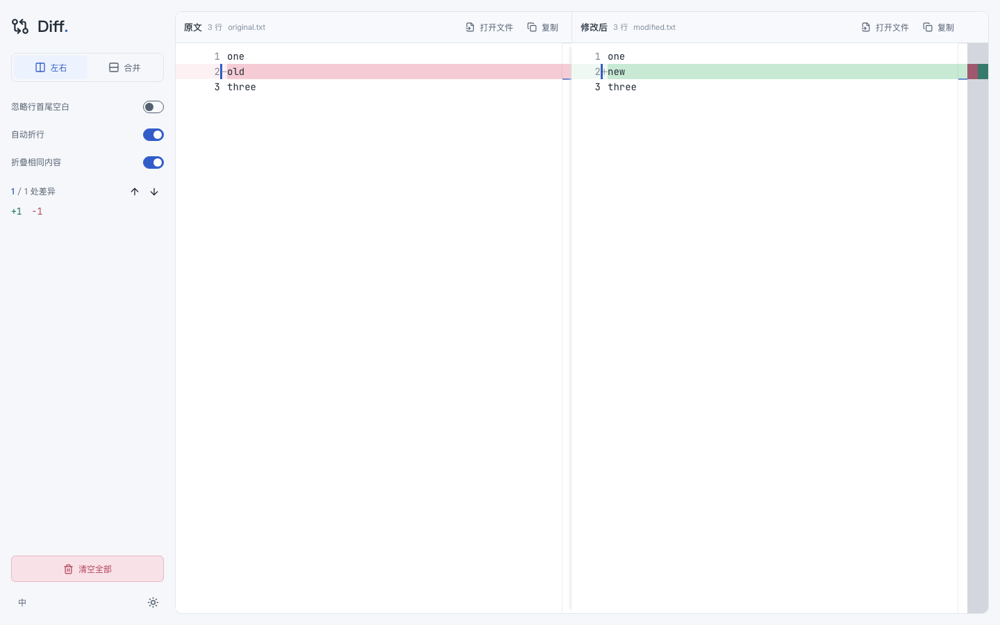

# Diff

基于 Astro + Vue 的文本差异对比工作台原型。支持中英文、明暗主题、左右及合并编辑对比。正文只在当前页面内存中处理，首次进入为空，不提供示例入口。

## 运行

需要 Node.js 22.13 或以上版本及 pnpm 10 或 11。

```sh
pnpm install
pnpm dev
```

项目已配置 `esbuild`、`workerd` 的安装脚本许可，同时兼容 pnpm 10 的
`onlyBuiltDependencies` 和 pnpm 10.26+ / 11 的 `allowBuilds`。两处许可名单需保持一致。
启动命令不自动安装依赖；首次运行、依赖变更或切换 pnpm 主版本后，请先执行
`pnpm install --frozen-lockfile`，再执行 `pnpm dev`。不同电脑之间不要复制 `node_modules`。

在浏览器打开终端输出的本地地址。默认端口为 13356，被占用时可能自动选择其他端口。

```sh
pnpm check
pnpm test
pnpm build
pnpm preview
```

## 格式化与代码检查

```sh
pnpm format        # 自动格式化，并修复可自动处理的 ESLint / Stylelint 问题
pnpm format:check  # 只检查，不修改文件（含 lint）
pnpm lint          # ESLint + Stylelint
pnpm lint:eslint   # 单独检查 JS、TS、Vue、Astro
pnpm lint:style    # 单独检查 CSS 及 Vue / Astro 的 style 块
```

- JS、TS、Vue 使用 `@lai9fox/eslint-config` 的格式规则，通过 ESLint 修复；Astro 补充 `eslint-plugin-astro` 检查。
- Astro、CSS、JSON、YAML、Markdown 使用 Prettier；`.prettierignore` 排除 ESLint 负责的文件、构建产物和自动生成的锁文件。
- Stylelint 使用标准规则和 `postcss-html` 解析组件样式。允许 Monaco 的既有类名；全局样式按组件组织，因此不检查选择器的降序优先级。
- Astro ESLint 插件使用兼容 Node.js 22.13 的 1.x 系列。

## 交付文档

- [需求说明](docs/requirements.md)
- [UI / UX 设计说明](docs/ui-ux-design.md)：设计决策、颜色与字体、页面布局、关键流程、状态、中英文文案及可访问性。

## 已实现功能

- 双侧纯文本编辑、文件选择与拖入、完整文本复制；首次进入为空，正文只存在当前页面内存中。
- Monaco advanced 行级与行内字符差异；忽略行首尾空白，CRLF / LF 等价，JSON 按原始文本比较。
- 单个 DiffEditor 切换左右 / 合并，保留撤销历史；左右视图固定等宽且双侧可编辑，合并视图为只读阅读视图，提供统一单行标题、文件操作菜单和一键返回左右编辑。
- 侧栏摘要显示差异块当前位置和 `+N −M`，支持上一处 / 下一处、F7 / Shift+F7、Alt+↑ / ↓。
- 清空两侧及文件名，提供一次撤销清空；编辑或导入后旧快照失效。
- 忽略行首尾空白、自动折行、折叠相同内容三个开关常驻，折行和折叠默认开启；差异状态区位于开关下方，采用与侧栏一致的背景。
- 中英、明暗切换。语言默认依据浏览器，主题默认跟随系统；主动选择后保存，正文不保存。
- 工作区固定视口满高，编辑器内部滚动；布局完全由用户控制，920px 及以下使用工具抽屉，标题栏通过 CSS `@container` 自适应。

## 库与适配边界

- Monaco Editor 0.57.0 自托管，只加载编辑器 API、图标、占位提示、剪贴板及通用 worker，不打包语言模块。
- 差异计算在 worker 中完成；对齐、折叠和同步滚动交由 Monaco。显示设置变化通过 updateOptions 更新同一实例。
- Vue 管理差异导航计数、行统计、文件、剪贴板、清空快照和界面偏好。主题颜色唯一来源是 global.css 的 CSS 变量。
- 移除 CodeMirror、补丁、自定义 diff 与页面滚动适配；抽屉改用原生滚动。
- 编辑器动态加载，加载时显示骨架；Monaco 内置提示接受英文。

## 验证记录

2026-11-17 Monaco 重构：

- `pnpm check`：类型检查通过。
- `pnpm test`：5 项纯函数测试通过，覆盖行统计、差异块定位、偏好解析和主题颜色规范化。
- `pnpm lint` / `pnpm build`：代码规范及静态站点构建通过。
- Chromium 浏览器验收通过：相同文本、中文字符高亮、忽略空白、CRLF / LF、JSON 顺序、视图切换与撤销、导航快捷键、清空恢复、文件拖入、原文粘贴、中英明暗切换及 375px 抽屉。无页面运行错误。
- 1 万行文本、单处替换的本机 Chromium 样本，差异更新约 245 ms；这是单次本机记录，不代表所有设备。
- 编辑器核心 JS gzip 711,630 B，worker gzip 92,187 B，合计 803,817 B（约 785 KiB）；未打包语言模块。Vite 仍提示未压缩 chunk 超过 500 kB。

## 界面截图

截图文本仅用于验收，产品首次打开仍为空。



[英文深色合并视图](docs/screenshots/monaco-inline-dark.png) · [375px 工具抽屉](docs/screenshots/monaco-mobile.png)
