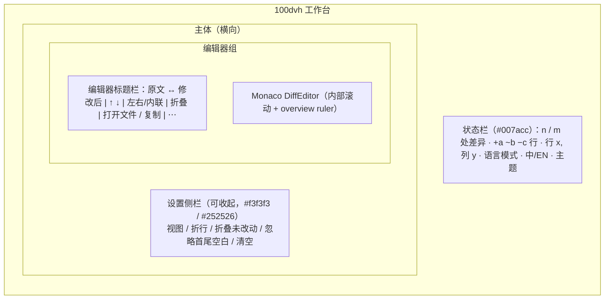
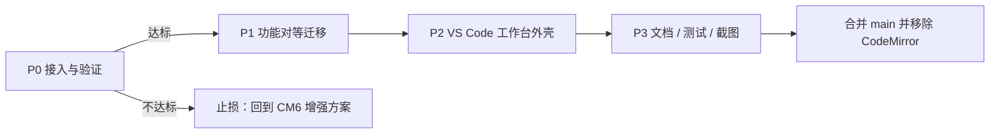

# Diff Workbench 输入组件改造计划：CodeMirror 6 → Monaco Editor

项目：`~/github/diff`（Astro 7 + Vue 3）
目标：编辑器的观感和编辑能力与 vscode.dev 保持一致（Monaco DiffEditor），外层界面改为轻量 VS Code 工作台风格。

## 1. 已对齐的决策

| # | 议题 | 结论 |
|---|---|---|
| 1 | 痛点 | **视觉质感**（字体渲染、行号/光标/选区、overview ruler）+ **编辑能力**（查找替换、多光标、列选择、括号匹配、行移动/复制） |
| 2 | 内核 | 换成 **Monaco Editor + DiffEditor**，重写 `Workbench.vue` |
| 3 | 对比方式 | **去掉**“行/单词/字符”下拉，统一使用 Monaco `advanced` 算法；删除 `@codemirror/merge` 补丁；A03 改在 Monaco 上重新验收 |
| 4 | 布局 | **全屏应用式**：100dvh，页面本身不滚动，只在编辑器内部滚动；移除 OverlayScrollbars 及页面滚动联动代码 |
| 5 | 合并视图 | 使用内联模式，**修改后一侧可编辑**；开启 `useInlineViewWhenSpaceIsLimited`，窗口变窄时自动切到内联 |
| 6 | 快捷键 | 完全沿用 VS Code：Alt+↑/↓ = 移动行；F7 / Shift+F7 与 Alt+F5 / Shift+Alt+F5 = 下一处/上一处差异；无障碍差异查看器改绑到 Ctrl/⌘+F7 |
| 7 | 主题 | Monaco 内置 `vs` / `vs-dark`；侧栏、标题栏等外层界面也换成 VS Code 配色 |
| 8 | 工作台外壳 | 轻量 VS Code 化：编辑器标题栏 + 可收起的“设置”侧栏 + 蓝色状态栏；**不做** Activity Bar |
| 9 | 移动端 | 窄屏能用就行：自动切到内联视图，设置面板改成抽屉；能查看、粘贴、导航，不保证手机上的编辑体验 |
| 10 | 接入方式 | npm **全量**引入 `monaco-editor`，Vite 打包 worker，从自己的站点加载，不走 CDN |
| 11 | 语法高亮 | 默认 plaintext；状态栏提供“语言模式”选择器，手动选择后两侧同时着色；不自动检测，不记住选择 |
| 12 | 国际化 | 加载时根据当前语言引入 Monaco 官方 zh-cn 语言包；外层界面可即时切换语言，Monaco 内部文案要刷新后才生效，刷新前弹出二次确认 |
| 13 | 实施节奏 | 在 `feat/monaco` 分支分 P0–P3 推进；P0 不达标可随时停下；全部完成后一次性合并，同时移除 CodeMirror |

## 2. 目标界面结构

## 3. 功能映射（现有 → Monaco）

| 现有功能 | Monaco 实现 | 备注 |
|---|---|---|
| 左右 / 合并切换 | `renderSideBySide` + `useInlineViewWhenSpaceIsLimited` + `renderSideBySideInlineBreakpoint` | 内联模式下可编辑 |
| 自动折行 | `diffWordWrap: 'on' \| 'off'`，原编辑器和修改编辑器各自设置 `wordWrap` | |
| 折叠相同内容（保留 3 行上下文） | `hideUnchangedRegions: { enabled, contextLineCount: 3, minimumLineCount, revealLineCount }` | 局部展开、全部展开都已内置 |
| 忽略行首尾空白 | `ignoreTrimWhitespace` | 默认 `false`，与 A09 一致 |
| CRLF 与 LF 视为相同 | 两侧 model 统一设为 `EndOfLineSequence.LF` | A10 需要回归测试 |
| 差异计数与导航 | `onDidUpdateDiff` → `getLineChanges()`；跳转用 `goToDiff('next' \| 'previous')` | 当前是第几处由光标所在行与 lineChanges 比对得出 |
| 当前差异块高亮 | 在当前块上加 `deltaDecorations`（左侧 3px accent 竖条） | 保留现有行为 |
| +/~/− 行统计 | 复用 `diff.ts` 的统计规则，输入改成 `ILineChange[]` | 统计始终按行计算 |
| “计算中”状态 | 编辑后到 `onDidUpdateDiff` 触发前显示计算中；设置 `maxComputationTime`，超时则提示并允许重试 | 计算未完成时不能显示“内容一致” |
| 双侧输入、撤销 | 原生支持（含多光标、列选择、查找替换、命令面板 F1、右键菜单） | |
| 打开文件 / 拖入文件 | 文件选择保持原生 `<input type=file>`；拖入时在编辑器容器上用 capture 阶段的 `drop` 拦截，用 `FileReader` 读取 | 读取失败时保留原内容（A11） |
| 复制整侧 | `model.getValue()` + Clipboard API | 不包含视图区、折叠提示（A15） |
| 清空 / 撤销清空 | 用 `pushEditOperations` 整段替换为空，并 `pushStackElement`；“撤销清空”按钮对两侧 model 执行 undo；用户输入后按钮消失 | Ctrl+Z 同样能撤销 |
| 空态提示 | 编辑器上叠加一层 placeholder（Monaco 没有通用的 placeholder），有内容时隐藏 | |
| 同步滚动 | 内置 | 删除 `scrolling.ts` |
| 明暗主题 | `monaco.editor.setTheme('vs' \| 'vs-dark')`，同时切换外层 CSS 变量 | 页面加载前预读偏好，避免闪烁 |
| 中英文 | 见决策 12 | |

## 4. 关键技术要点

> [!IMPORTANT]
> **全量引入要关掉语言服务诊断**：全量包带有 TS/JSON/CSS/HTML 语言服务。用户选择语言模式后，这些服务会对内容做校验并画红色波浪线，这不适合 diff 工具。初始化时需要关闭：
> `typescriptDefaults / javascriptDefaults.setDiagnosticsOptions({ noSemanticValidation: true, noSyntaxValidation: true })`、`jsonDefaults.setDiagnosticsOptions({ validate: false })`、css/scss/less/html 也同样关闭 lint。

- **SSR**：工作台改为 `client:only="vue"`，Monaco 在 `onMounted` 中动态 `import()`；加载期间显示 VS Code 风格的骨架屏。
- **Worker**：通过 `self.MonacoEnvironment.getWorker` 加 Vite 的 `?worker` 导入 editor / json / css / html / ts 五个 worker。
- **快捷键**：用 `monaco.editor.addKeybindingRules` 解绑 Alt+↑/↓ 上原有的自定义导航，把 F7 / Shift+F7 / Alt+F5 / Shift+Alt+F5 绑到 goToDiff，把 `editor.action.accessibleDiffViewer.next/prev` 改绑到 Ctrl/⌘+F7 / Ctrl/⌘+Shift+F7。
- **布局**：容器尺寸用 `ResizeObserver` 驱动 `diffEditor.layout()`，或者开启 `automaticLayout: true`。
- **字体**：沿用 Monaco / VS Code 默认等宽字体栈（Menlo / Consolas）。同时移除 `@fontsource/jetbrains-mono`。
- **隐私**：worker 和语言包都从本站加载，没有第三方请求；正文只放在内存 model 中（A17）。

## 5. 依赖增删

- **新增**：`monaco-editor`
- **移除**：`@codemirror/commands`、`@codemirror/merge`、`@codemirror/state`、`@codemirror/view`、`overlayscrollbars`、`@fontsource/jetbrains-mono`、`patches/@codemirror__merge@6.12.2.patch`，以及 `pnpm-workspace.yaml` 里对应的 patchedDependencies
- **删除或重写的文件**：`src/lib/editor.ts`、`src/lib/scrolling.ts`、`src/lib/page-layout.ts`、`src/components/CustomSelect.vue`（如果语言模式选择器复用它就保留）、`Workbench.vue` 重写、`global.css` 改为 VS Code token
- **新增文件（建议）**：`src/lib/monaco/setup.ts`（环境、worker、诊断、快捷键）、`src/lib/monaco/stats.ts`、`src/components/DiffEditor.vue`、`StatusBar.vue`、`EditorTitleBar.vue`、`SettingsPanel.vue`

## 6. 分阶段实施

### P0 接入与验证（门槛）
1. 建 `feat/monaco` 分支，安装 `monaco-editor`，在 Astro 中以 `client:only` 渲染一个最小 DiffEditor。
2. 验证以下三项：
   - **A03 中文细粒度**：长段中文只改几个字时，要求只高亮变化的字符。
   - **A16 性能**：几千行代码或几万字中文时，输入、滚动、导航都不卡顿。
   - **打包体积**：记录 gzip 后的总体积和首屏加载时间，并确认没有单个文件超过 Cloudflare Pages 的 25 MiB 限制。
3. 输出验证记录。如果 A03 不达标，考虑用 `experimental.showMoves`、调整 `diffAlgorithm` 或用 decoration 补救，仍不行就止损。

### P1 功能对等迁移
- 按第 3 节逐项迁移：视图切换、折行、折叠、忽略空白、CRLF、计数与导航、当前块高亮、统计、计算中状态、文件导入与拖入、复制、清空与撤销清空、空态、主题、快捷键、诊断关闭、zh-cn 语言包。

### P2 VS Code 工作台外壳
- 100dvh 布局，包括编辑器标题栏、可收起的设置侧栏（窄屏为抽屉）和状态栏（含语言模式选择器、中/EN、主题）。
- 外层配色使用 VS Code token。浅色：编辑器 `#ffffff`、侧栏 `#f3f3f3`、标题栏 `#dddddd`、状态栏 `#007acc`；深色：`#1e1e1e` / `#252526` / `#3c3c3c` / `#007acc`。UI 字体用系统字体 13px，焦点描边 `#0090f1`。
- 切换语言时弹出刷新确认。

### P3 文档、测试、截图
- **`docs/requirements.md` 需要修改的条目**：去掉“对比方式”；合并视图改为“可编辑，窄屏自动内联”；语法着色改为“默认纯文本，可手动选择语言”；滚动改为“编辑器内滚动”；快捷键改为 VS Code 键位；新增 overview ruler、查找替换、多光标。
- 同步更新 `docs/ui-ux-design.md` 和 README（功能列表、库与适配边界、截图）。
- **测试**：`tests/core.test.mjs` 改为测试 `stats.ts`（ILineChange → +/~/−）；建议新增 Playwright 端到端用例，覆盖 A01–A18 中依赖 Monaco 行为的条目（A03 / A05 / A07 / A09 / A10 / A11 / A15 / A18）。
- 跑通 `pnpm check / lint / test / build`，并在 1440×900、820px、375px 下分别截取明暗和中英文截图。

## 7. 风险与应对

| 风险 | 影响 | 应对 |
|---|---|---|
| Monaco 的中文字符级 diff 不如现有补丁精细 | A03 不达标 | 在 P0 先验证；止损线是退回 CM6 增强方案 |
| 全量包体积大（预计 gzip 后数 MB） | 首屏变慢 | 懒加载 + 骨架屏；以后如有需要可再改为按需引入 |
| Monaco 官方不支持移动端 | 手机上编辑体验差 | 已确认只做降级 |
| 内联模式可编辑后与原需求冲突 | 验收口径变化 | 在 P3 修改需求文档 |
| 语言包无法热切换 | 切换中/EN 需要刷新 | 刷新前二次确认（正文不持久化） |

## 8. 当前验证记录（2026-11-05）

- Monaco 0.57.0 `advanced` 算法：一段约 400 字的中文中替换一个字，返回的行内范围仅覆盖该字；浏览器中已查看双侧差异。
- 算法烟测（本机 Node.js，非完整交互性能验收）：5,000 行代码一次变化约 5 ms，约 4 万字中文一次变化约 9 ms，均未超时。尚需在固定参考浏览器上测量输入、滚动和导航体验。
- 静态构建（2026-11-05）：103 个文件，原始共 14,407,077 字节，逐文件 gzip 共 3,462,747 字节；最大文件 `ts.worker` 为 6,928,898 字节，小于 25 MiB。尚未记录首屏加载时间。
- 浏览器手动检查：双侧输入、清空与撤销、内联切换、375px 布局。尚未完成规定的全部尺寸、主题、语言截图和 A01–A18 端到端回归。
- Monaco 0.57.0 的 npm ESM 包未包含可直接加载的官方中文 NLS 文件；外壳可切换语言，编辑器内部仍为英文，此项未完成。
